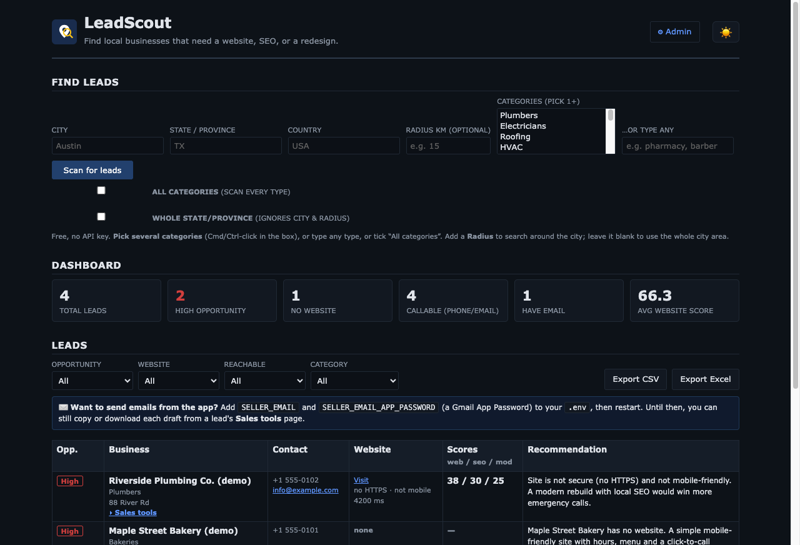
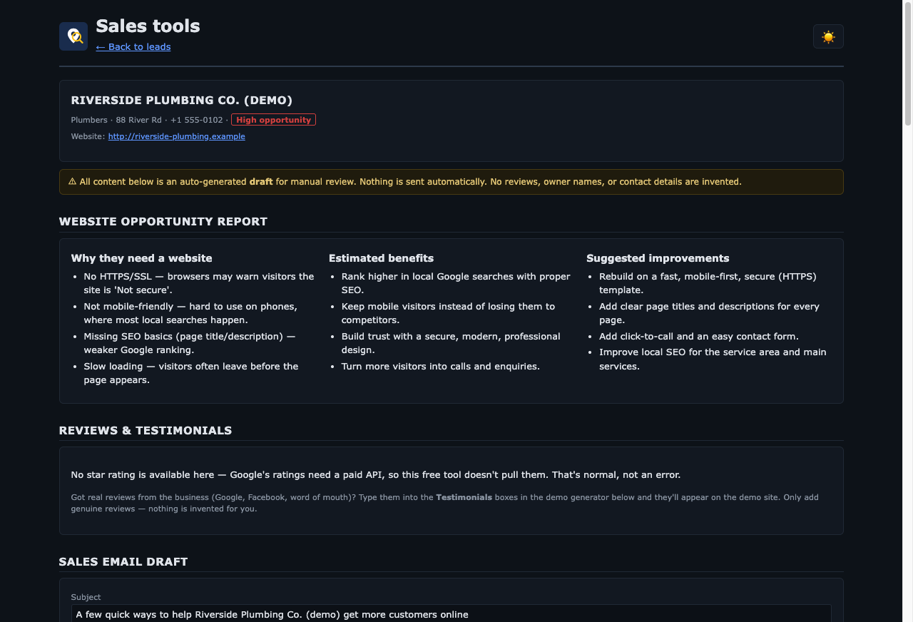

# LeadScout

A lightweight, **self-hosted** tool that finds local businesses which need a
website, SEO, or a redesign — so web-design / SEO / marketing agencies and
freelancers can generate sales leads.

- Enter a **city, state/province, country, and business category**.
- LeadScout finds nearby businesses from **OpenStreetMap** (free, no API key).
- It **analyses each website** (HTTPS, mobile, speed, SEO basics, links…) and
  scores it 0–100.
- It classifies every lead as **High / Medium / Low opportunity** and writes a
  short **sales recommendation**.
- Browse a **dashboard**, filter the table, and **export to CSV or Excel**.
- **Light & dark mode** (remembers your choice), plus a **★ All categories**
  scan that finds every business type in one pass.

No accounts, no auth, no subscriptions, no paid APIs. Just run it.

### Sales & website-generation workflow
Every lead has a **▸ Sales tools** page (`/lead/{id}`) to help you convert it:

- **Website opportunity report** — why the business needs a website, estimated
  benefits, and suggested improvements.
- **Sales email draft** — a personalised outreach email (subject + body). Copy,
  download, or edit it. **Emails are never sent** — drafts only.
- **Phone call script** — a personalised, low-pressure script for when you reach
  the owner/manager: opening, discovery questions, the pitch, objection handling,
  a voicemail version, and the close. Copy or download it.
- **Demo website generator** — a complete, responsive starter site built from the
  business's data, with a category-aware structure (restaurants get a *Menu*,
  dentists get *Book Appointment*, etc.). Live **desktop/mobile preview**,
  editable headline/colour/contact info, and **one-click ZIP export**
  (index.html, style.css, script.js, README, deploy guide).
- **Package estimator** — editable Starter / Professional / Premium pricing.

All generated content is **template-based and clearly labelled as a draft** for
review. Nothing is fabricated — no invented owners, contacts, reviews, or
testimonials. Where data is missing, the site shows clearly-marked placeholders.



<details>
<summary>Sales tools page (opportunity report, email draft, call script, demo site)</summary>



</details>

*Screenshots use made-up demo businesses.*

## Run the tests

```bash
pip install -r requirements.txt pytest
pytest -q tests      # 19 offline tests, no network needed
```

---

## What's new in 2.1

- **Up-to-date stack:** FastAPI 0.143, Starlette 1.8, SQLAlchemy 2.1, pywebview 6
  and current versions of everything else (1.x pinned mid-2024 releases).
- **Admin login lockout:** 5 wrong passwords from one address locks it out for
  5 minutes, so the admin password can't be brute-forced once you host it.
- **Secure cookies when hosted:** the admin session cookie is marked `Secure`
  automatically behind HTTPS (including platforms that terminate TLS for you).
- **Mac app launcher** finds its project folder wherever it lives.

---

## What data you get per lead

| Field | Source |
|---|---|
| Business name, phone, email, website, address | OpenStreetMap tags |
| Google Maps link | generated from coordinates |
| Facebook / Instagram / LinkedIn / Twitter | OSM `contact:*` tags |
| Owner / operator | OSM `operator` tag (when present) |
| Website score, SEO score, modernization score | live website analysis |
| Opportunity level + recommendation | computed |

### 100% free — no keys, no billing, no limits to worry about
LeadScout uses only **free, open OpenStreetMap services** (Nominatim + several
public Overpass mirrors). There is **nothing to sign up for and no credit card
anywhere**. If one free Overpass mirror is busy, the app automatically falls
back to the next one, so searches keep working.

### The one thing free data can't give you: Google reviews & ratings
Google **review counts and star ratings are Google-proprietary** — no free/open
source has them. Those two columns exist in the schema/exports but are left
**blank** in free mode. Everything else — name, phone, email, website, address,
socials, and the full live website analysis — is real and 100% free.

---

## Run as a Mac app (no browser)

Double-click **`LeadScout.app`** in the project folder. It opens LeadScout in its
own native window — no browser, no Terminal. You can drag `LeadScout.app` to your
Applications folder or keep it in the Dock.

- First launch sets up a local environment automatically (may take a minute).
- The app path is embedded in `LeadScout.app/Contents/MacOS/LeadScout`; if you
  move the whole project folder, update that path.
- Prefer the command line? `python -m app.desktop` opens the same window.

## Quick start (Docker — recommended)

```bash
cp .env.example .env        # optional: edit USER_AGENT with your email
docker compose up --build
```

Open <http://localhost:8000>.

## Quick start (local Python)

```bash
python -m venv .venv && source .venv/bin/activate
pip install -r requirements.txt
uvicorn app.main:app --reload
```

Open <http://localhost:8000>.

---

## How to use

1. Type a **City** (State/Province and Country improve accuracy).
   - **Whole-state scan:** tick *"Search the whole state/province"* and just fill
     in State/Province — LeadScout scans the entire state instead of one city
     (up to `MAX_BUSINESSES_STATE` businesses; it takes longer).
2. Pick a **Category** from the dropdown, choose **★ All categories** to scan
   every business type at once (each lead is auto-labelled by type), **or type
   any business type** in the "…or type any" box (e.g. `pharmacy`, `barber`,
   `tattoo`, `butcher`). The typed value overrides the dropdown; common words
   like "mechanic" or "attorney" are mapped automatically, and anything else is
   matched against OpenStreetMap tags.
3. Click **Scan for leads**. Bigger areas take longer because each website is
   fetched and analysed.
4. Use the **Opportunity / Website / Category** filters, then **Export CSV/Excel**.
   Set **Website → No website** to list only businesses that have no site at all.

**High-opportunity** leads (no website, or a broken / non-mobile / non-HTTPS
site with weak SEO) are your best prospects and sort to the top.

---

## REST API

| Method | Path | Description |
|---|---|---|
| `POST` | `/api/search` | Run a search. Form fields: `city`, `state`, `country`, `category`. |
| `GET`  | `/api/leads` | List leads. Query: `opportunity`, `has_website` (0/1), `category`, `search_id`. |
| `GET`  | `/api/stats` | Dashboard totals. |
| `GET`  | `/api/categories` | Supported categories. |
| `GET`  | `/export/csv`, `/export/xlsx` | Download (same filters as `/api/leads`). |
| `GET`  | `/healthz` | Health check. |

Example:

```bash
curl -X POST http://localhost:8000/api/search \
  -F city="Austin" -F state="TX" -F country="USA" -F category="Plumbers"

curl "http://localhost:8000/api/leads?opportunity=High"
```

Interactive API docs are auto-generated at `/docs`.

---

## Project layout

```
.
├── app/
│   ├── main.py          # FastAPI routes (HTML + REST + exports)
│   ├── osm.py           # OpenStreetMap geocoding & business search
│   ├── analyze.py       # website fetch + scoring
│   ├── recommend.py     # rule-based sales recommendations
│   ├── export.py        # CSV / XLSX
│   ├── database.py      # SQLite helpers (stdlib only)
│   ├── config.py        # env-var config
│   ├── templates/index.html
│   └── static/          # style.css, logo.svg
├── schema.sql           # database schema
├── Dockerfile
├── docker-compose.yml
├── .env.example
├── requirements.txt
└── docs/DEPLOYMENT.md   # VPS deployment guide
```

The SQLite database is created automatically at `DB_PATH` on first run.

---

## Configuration

All settings are environment variables (see `.env.example`): `DB_PATH`,
`NOMINATIM_URL`, `OVERPASS_URL`, `USER_AGENT`, `MAX_BUSINESSES`,
`ANALYZE_CONCURRENCY`, `SITE_TIMEOUT`, `OVERPASS_TIMEOUT`, `CHECK_BROKEN_LINKS`.

---

## Deployment

See [docs/DEPLOYMENT.md](docs/DEPLOYMENT.md) for a step-by-step VPS guide
(Docker + optional Nginx/HTTPS reverse proxy).

---

## Please use it responsibly

- OpenStreetMap data is © OpenStreetMap contributors, licensed **ODbL** — keep
  attribution if you republish it.
- Nominatim/Overpass are free community services with **usage limits**. Set a
  real `USER_AGENT`, don't hammer them, and consider self-hosting them for heavy
  use.
- Only public data is collected. Respect anti-spam / cold-outreach laws
  (CAN-SPAM, CASL, GDPR, TCPA, local Do-Not-Call rules) when you contact leads.

## License

MIT — do what you like. Provided as-is, without warranty.
